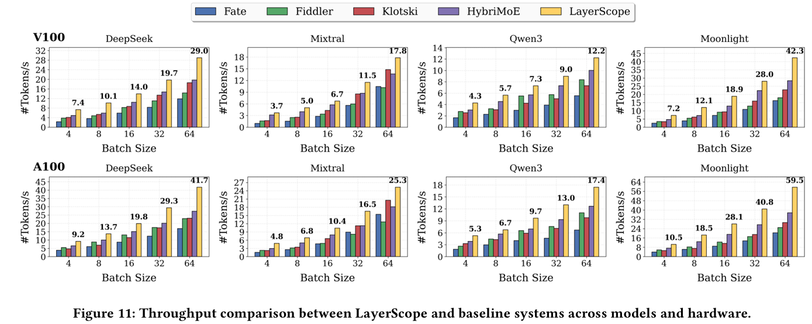
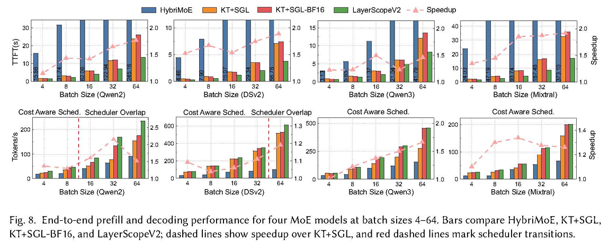

# LayerScope and LayerScopeV2

[English](README.md) | [简体中文](README_ZH.md)

Predictive cross-layer scheduling and AMX-accelerated CPU-GPU co-execution for memory-constrained Mixture-of-Experts (MoE) inference.

## Overview

Although an MoE model activates only a few experts for each token, all expert weights must remain available in memory. When they do not fit in GPU memory, the system must choose between transferring an expert to the GPU and executing it directly on the CPU. End-to-end performance therefore depends on expert placement, PCIe transfers, CPU/GPU execution, and scheduling overhead—not on GPU computation alone.

LayerScope and LayerScopeV2 address this problem from two successive angles.

### LayerScope (ICS 2026)

LayerScope is a prediction-driven expert scheduling system for multi-batch MoE inference on commodity and legacy CPU-GPU servers. It uses future routing information to coordinate computation and data movement across layer boundaries:

- **LLaPor, a layer-aware predictor:** distinguishes near-input, near-output, and middle layer groups, and uses their routing and hidden-state characteristics to predict experts in subsequent layers. It supports online continuous learning.
- **PreSched, a prefetch-aware cross-layer scheduler:** jointly considers current-layer demand and predicted next-layer demand. Under a shared PCIe budget, it chooses CPU execution, on-demand GPU loading, or cross-layer prefetching according to their estimated global benefit.
- **AsyncIO, an asynchronous I/O optimizer:** uses fixed transfer buffers, fine-grained expert chunks, and multiple streams to overlap expert transfers with CPU/GPU computation.

LayerScope targets platforms where limited GPU memory and PCIe latency make naïve on-demand expert loading inefficient.

### LayerScopeV2 (submitted to TACO)

LayerScopeV2 brings LayerScope's predictive scheduling foundation to KTransformers+SGLang (KT+SGL) and redesigns it for AMX-accelerated CPU execution. Faster CPU experts change both the weight-layout requirements and the point at which scheduling becomes profitable. LayerScopeV2 therefore adds:

- **Checkpoint-native BF16 AMX kernels:** hand-written AVX-512 gathering and AMX GEMM kernels directly consume row-major BF16 checkpoint weights. Only transient activations are reorganized, avoiding runtime weight quantization or repacking and persistent duplicate weight layouts.
- **AMX-aware Cost-Aware Scheduling:** an aggregate AMX thread-pool latency model enables dynamic expert placement and cross-layer prefetching only when their predicted benefit exceeds computation, transfer, and scheduling costs. Unprofitable scheduling is bypassed.
- **Scheduler Overlap:** experts committed to CPU execution are submitted before the remaining placement decisions finish, hiding most scheduler latency behind useful CPU work.

This repository hosts the KTransformers-side LayerScopeV2 artifact, including the native BF16 AMX kernels, CPU/GPU expert-mask interfaces, and launch/profiling scripts. The matching [always-H/sglang](https://github.com/always-H/sglang) repository provides the cross-layer predictor, cost-aware runtime scheduling, prefetching, and Scheduler Overlap integration. The Quick Start below runs the combined LayerScopeV2 system.

## Key Results

### LayerScope: end-to-end throughput

On NVIDIA V100 and A100 GPUs with a 24 GB memory budget, LayerScope achieves up to **141% higher end-to-end throughput than Klotski** and **70.8% higher throughput than HybriMoE** across DeepSeek-V2-Lite, Mixtral-8x7B, Qwen3-30B-A3B, and Moonlight-16B-A3B at batch sizes 4-64.



*LayerScope paper, Figure 11: end-to-end throughput across four MoE models and two GPU platforms.*

### LayerScopeV2: prefill and decoding

On an NVIDIA RTX A6000 and an Intel Xeon Gold 6430, LayerScopeV2 reduces prefill time to first token (TTFT) by **13.4%-48.0%** (up to **1.92x speedup**) and achieves up to **2.16x the end-to-end decoding throughput of KT+SGL**. The evaluation covers Qwen2-57B-A14B, DeepSeek-V2-Lite, Qwen3-30B-A3B, and Mixtral-8x7B.



*LayerScopeV2 paper, Figure 8: prefill TTFT and decoding throughput; the dashed lines show speedup over KT+SGL and scheduler transitions.*

## Quick Start

The following example runs LayerScopeV2 with DeepSeek-V2-Lite in BF16 on one GPU. Both devices use the original BF16 checkpoint as their weight source; no CPU-weight quantization or layout conversion is required.

### 1. Requirements

- Linux x86-64, Python 3.10 or newer (Python 3.11 recommended), and a working C/C++ build toolchain.
- An Intel CPU with AMX-BF16 and AVX-512 support, an NVIDIA CUDA GPU, and enough host memory for the model's expert weights.
- Model weights downloaded locally; model files are not included in either repository.

The commands below use Conda and Debian/Ubuntu package names; adapt them to your environment when necessary. The current scheduling and calibration path targets BF16 SiLU experts on a single GPU with TP=1/PP=1. DeepSeek-V2-Lite is the reference configuration below. Other models and hardware require appropriate resident-expert settings, recalibration, and independent validation.

### 2. Build the LayerScopeV2 kernel

```bash
git clone --branch master https://github.com/always-H/ktransformers.git
cd ktransformers
git submodule update --init --recursive

conda create -n layerscope python=3.11 -y
conda activate layerscope

cd kt-kernel
sudo apt update
sudo apt install -y build-essential libhwloc-dev pkg-config
python -m pip install --upgrade pip setuptools wheel cmake pybind11
./install.sh
python -c "from kt_kernel import kt_kernel_ext; print('kt-kernel import OK')"
```

`install.sh` detects the local CPU and builds the native extension.

### 3. Install the matching SGLang runtime

Use the LayerScopeV2 runtime fork rather than stock SGLang. Starting from the `kt-kernel` directory above:

```bash
cd ../..
git clone https://github.com/always-H/sglang.git
cd sglang
pip install -e python
export PYTHONPATH="$PWD/python${PYTHONPATH:+:$PYTHONPATH}"
```

Keep this kernel and runtime in the same Python environment for calibration, serving, and benchmarking.

### 4. Configure and calibrate the scheduler

Replace `MODEL_ROOT` with the directory containing your models. The values below use one GPU, 32 CPU workers, one NUMA pool, and six resident GPU experts for DeepSeek-V2-Lite.

```bash
export CUDA_VISIBLE_DEVICES=0
export SGLANG_KT_ENABLE_SCHEDULER=1
export SGLANG_KT_ENABLE_EARLY_CPU=1
export SGLANG_KT_ENABLE_PREFETCH=1
unset SGLANG_KT_BUDGET_PROFILE SGLANG_KT_SCHEDULER_TRANSFER_LIMIT

export MODEL_ROOT=/path/to/models
export MODEL_NAME=DeepSeek-V2-Lite
export MODEL_PATH="$MODEL_ROOT/$MODEL_NAME"
export KT_WEIGHT_PATH="$MODEL_PATH"
export CPU_THREADS=32
export NUMA_POOLS=1
export NUM_GPU_EXPERTS=6
export BUDGET_PROFILE="$PWD/kt-budget.json"

python -m sglang.srt.layers.moe.kt_budget \
  --model-config "$MODEL_PATH/config.json" \
  --kt-cpuinfer "$CPU_THREADS" \
  --kt-threadpool-count "$NUMA_POOLS" \
  --kt-num-gpu-experts "$NUM_GPU_EXPERTS" \
  --batch-size 4 \
  --budget-max-tokens 512 \
  --budget-output "$BUDGET_PROFILE"
```

Calibration measures the local AMX, GPU, PCIe, and scheduling paths and produces a reusable cost-aware scheduling profile. This example starts at four tokens and doubles the load up to 512, covering 4, 8, 16, 32, 64, 128, 256, and 512. Adjust `--batch-size` and `--budget-max-tokens` to cover the expected MoE token loads. Use a new output path when recalibrating because existing profiles are not overwritten. Without a profile or an explicit diagnostic transfer limit, dynamic scheduling remains bypassed.

### 5. Launch the server and send a request

Keep the environment variables and numerical settings from the calibration step unchanged:

```bash
export SGLANG_KT_BUDGET_PROFILE="$BUDGET_PROFILE"

python -m sglang.launch_server \
  --model-path "$MODEL_PATH" \
  --served-model-name layerscope-demo \
  --host 0.0.0.0 \
  --port 8000 \
  --kt-weight-path "$KT_WEIGHT_PATH" \
  --kt-method BF16 \
  --kt-cpuinfer "$CPU_THREADS" \
  --kt-threadpool-count "$NUMA_POOLS" \
  --kt-num-gpu-experts "$NUM_GPU_EXPERTS" \
  --tensor-parallel-size 1 \
  --trust-remote-code \
  --disable-cuda-graph
```

From another terminal, send an OpenAI-compatible request:

```bash
curl http://localhost:8000/v1/chat/completions \
  -H "Content-Type: application/json" \
  -d '{
    "model": "layerscope-demo",
    "messages": [{"role": "user", "content": "Give a short introduction to MoE inference."}],
    "max_tokens": 32
  }'
```

This single-request call is an API smoke test, not a scheduling performance test. Its decode load is normally one token, outside the calibrated range, so it is not expected to exercise dynamic scheduling. Use the calibrated fixed-batch benchmark below to evaluate scheduling behavior.

### 6. Run fixed-batch benchmarks (optional)

Stop the server before using the same GPU for benchmarking. The following command uses the model and worker settings exported above and writes per-batch logs under `kt-kernel/logs/`:

```bash
cd ../ktransformers/kt-kernel
BATCH_SIZES="4 8 16 32 64" INPUT_LEN=512 OUTPUT_LEN=32 \
  bash sgl_kt/run_bench_one_batch.sh
```

Additional launch and profiling entry points are available in [`kt-kernel/sgl_kt/`](kt-kernel/sgl_kt/). For static, on-demand, and prefetch comparisons, use the runtime repository's [`multi_batch_benchmark.sh`](https://github.com/always-H/sglang/blob/main/benchmark/kt/multi_batch_benchmark.sh).

## Citation

If you use LayerScope or LayerScopeV2 in your research, please cite the corresponding paper.

### LayerScope

```bibtex
@inproceedings{yu2026layerscope,
  title={LayerScope: Predictive Cross-Layer Scheduling for Efficient Multi-Batch MoE Inference on Legacy Servers},
  author={Yu, Enda and Dong, Dezun and Zhang, Zhaoning and Bai, Zhe and Yang, Weiling and Wang, Haojie and Li, Dongsheng and Wu, Yongwei and Liao, Xiangke},
  booktitle={Proceedings of the 40th ACM International Conference on Supercomputing},
  pages={881--892},
  year={2026}
}
```

### LayerScopeV2

```bibtex
@inproceedings{bai2026layerscopev2,
  title={LayerScopeV2: Predictive Cross-Layer Scheduling with AMX Acceleration for Memory-Bound MoE Inference},
  author={Bai, Zhe and Yu, Enda and Yang, Weiling and Dong, Dezun},
  booktitle={submitted to TACO},
  year={2026}
}
```
